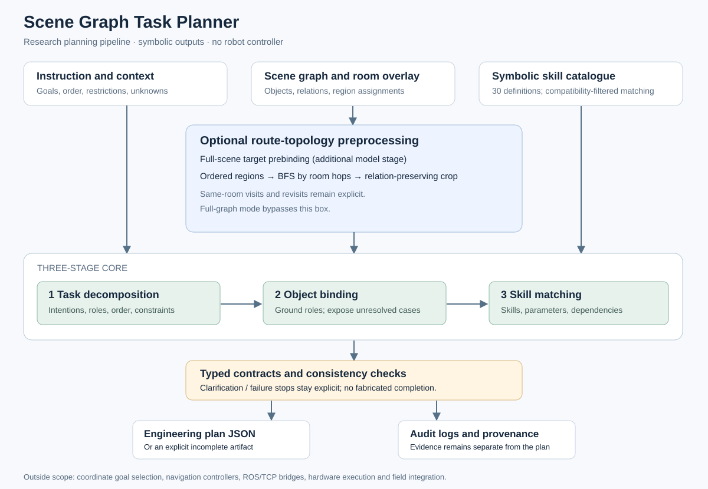

# Scene Graph Task Planner

Repository: [StarCo-Lewis/scene-graph-task-planner](https://github.com/StarCo-Lewis/scene-graph-task-planner).

A planning-only release of a three-stage, scene-graph-grounded task planner. A natural
language instruction and a 3D scene graph go in. A symbolic engineering plan comes out,
either complete or explicitly incomplete. Nothing is executed.



## What this release does

- **Full-graph planning.** Three stages run on the supplied scene graph: task
  decomposition, object binding, then skill matching. The program validates every typed
  structure and assembles `engineering_plan.json`. If any stage stops, the plan is
  `null` and the artifact is marked `incomplete`; no steps are made up.
- **Route-topology preprocessing.** Ordered targets are prebound against the full scene,
  mapped to rooms, and routed by breadth-first search over room connections (a hop
  count, not a distance). The scene is cropped to the route, and the same three-stage
  core is run on the crop.
- **Model backends.** The default backend is `offline`: no request is ever sent. A live
  model runs only when you pass both `--backend live` and `--acknowledge-live-api`.

## What it does not do

- It does not execute plans or turn objects into navigation goals. There is no
  localization, map processing, route following, obstacle avoidance, ROS/TCP bridge or
  hardware command. That work belonged to external collaborators and is not part of
  this repository.
- It does not include the room-recursive planner. That variant is documented for
  historical comparison only; see [docs/room_recursive_variant.md](docs/room_recursive_variant.md).
- It claims no physical capability. A complete plan is a symbolic proposal, not
  permission to execute.

## Requirements

Python 3.10 or newer. Only the standard library is needed for everything in this
release. Some unused legacy code paths import `torch`, `open_clip` or
`sentence_transformers` inside functions; no command here reaches them.

## Quick start

Run from the release root. Multi-line examples below use Bash/WSL syntax; the test
command also works directly in PowerShell.

```
python -m unittest discover -s tests -v
python -m sgtp toy-scene --out-dir runs/toy
python -m sgtp plan --scene-dir examples/toy_scene \
    --instruction "Visit the red marker, then the blue marker, and finally return to the red marker." \
    --backend synthetic --plan-scope demo --out-dir runs/plan1
python -m sgtp verify-lock
```

`--backend synthetic` is an exact-label test double, not a model. It exists so the
copied pipeline can run end to end offline. Its plan for the toy scene visits ids
10, 11, 10 with `navigate_to_object`. See [docs/cli.md](docs/cli.md) for the topology
chain and every option.

Exit codes: `0` complete plan (or command succeeded), `2` usage or input error,
`3` controlled stop or incomplete plan. An engineering JSON is still written on exit 3.

Validated offline: **44 tests passed on Python 3.12.10**, including the genuine
three-stage synthetic path, topology handoff and replay-input mismatch rejection.
No model API or robot was contacted. See [docs/validation.md](docs/validation.md).

## Skills: 48 requirements, 30 catalogue entries, 12 offered

These three numbers measure different things:

| Set | Size | Meaning |
|---|---:|---|
| Skill requirements (latest meeting list) | 48 | What the team wants; see [docs/skill_requirements.md](docs/skill_requirements.md) |
| Formal symbolic catalogue v0.3.2 | 30 | Symbolic skill definitions, published in `catalogues/` |
| Offered to the planner by default | 12 | Entries the inherited action-matrix wire can encode; see [docs/skill_wire_compatibility.md](docs/skill_wire_compatibility.md) |

The other 18 catalogue entries are withheld. Each run lists them, with reasons, in
`catalogue_runtime_gap.json`, and the planner is told not to substitute an offered skill
for a withheld one. Several offered skills require a `reachable` precondition that no
offered skill produces, so their feasibility stays `unknown`. See
[docs/catalogue.md](docs/catalogue.md).

## Documentation

- [docs/architecture.md](docs/architecture.md): components and data flow
- [docs/io.md](docs/io.md): input files and output artifacts
- [docs/cli.md](docs/cli.md): commands, backends and exit codes
- [docs/catalogue.md](docs/catalogue.md): catalogue profiles and the runtime gap
- [docs/adapters.md](docs/adapters.md): every change made to the copied code
- [docs/methods.md](docs/methods.md): planning methods and release scope
- [docs/results.md](docs/results.md): historical diagnostic results (saved, not re-run)
- [docs/failure_cases.md](docs/failure_cases.md) and [docs/task_ratings.md](docs/task_ratings.md)
- [docs/upload.md](docs/upload.md): repository naming and upload notes

## Layout

| Path | Content |
|---|---|
| `embodied_pipeline/` | Planning, topology filter and validation code copied from the research workspace |
| `vendor/legacy_engines/` | The three legacy planning engines, plus the release backend switch |
| `sgtp/` | Release command line, toy scene, synthetic responder and source lock |
| `catalogues/` | Formal catalogue v0.3.2, historical library 0.2.0 and the compatibility report |
| `examples/` | Synthetic toy scene |
| `tests/` | Offline tests |
| `RELEASE_PROVENANCE.json` | Every copied file with original and release hashes |
| `release_source_lock.json` | SHA-256 of every shipped file |

## Provenance, attribution and license

Code under `embodied_pipeline/` and `vendor/legacy_engines/` was copied from the
authors' research workspace. 48 files are byte-identical. Six are adapted, and each
adapted file is marked in the source and in
[docs/adapters.md](docs/adapters.md). `RELEASE_PROVENANCE.json` records both hashes for
every copied file.

No license is specified by this release, and preparing it grants no new software or
data license. Keep any existing LICENSE or NOTICE files, and their attributions, when
publishing. Scene assets and raw run logs are not redistributed.
