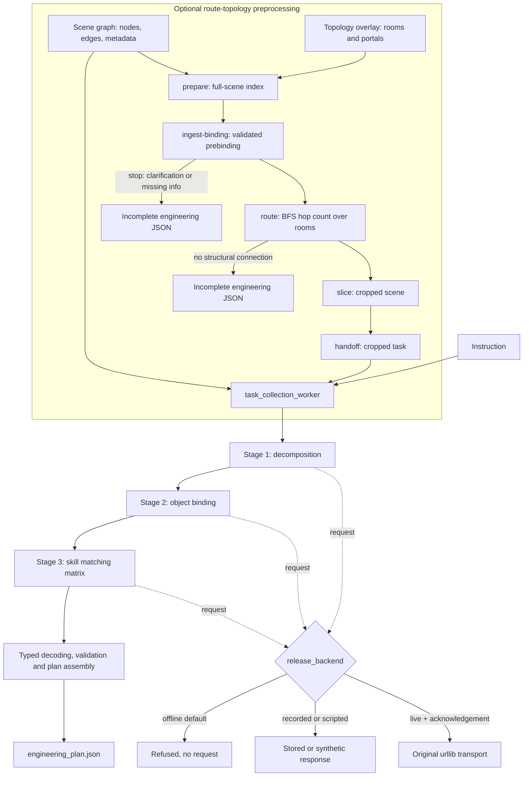

# Architecture

The diagram file is `figures/architecture.svg`. This page gives the same flow as text.

## Components

| Component | Location | Role |
|---|---|---|
| Release CLI | `sgtp/cli.py` | Validates options, sets the backend environment, runs the worker once, writes `release_run.json` |
| Worker | `embodied_pipeline/orchestration/task_collection_worker.py` | Snapshots inputs, runs the three stages, writes the engineering envelope for every outcome |
| Alignment subprocess | `embodied_pipeline/planning/intent_alignment_worker.py` and `vendor/legacy_engines/object_alignment_v1/` | Stages 1 and 2 (decomposition and object binding) |
| Skill matching | `vendor/legacy_engines/skill_matching_v1/` | Stage 3 and plan assembly |
| Typed identifiers | `vendor/legacy_engines/llm_audit_v1/` | Hash-scoped codebooks and schema checks for all three stages |
| Topology filter | `embodied_pipeline/topology_filter/` | Overlay checks, prebinding validation, BFS routing, cropping, handoff |
| Backend switch | `vendor/legacy_engines/release_adapters/release_backend.py` | Decides what happens to each already-built request |
| Catalogue profiles | `embodied_pipeline/_release.py` | Selects and hash-checks one skill catalogue |

## Process boundary

The worker starts stages 1 and 2 in a child Python process (`python -m
embodied_pipeline.planning.intent_alignment_worker`, working directory = release root).
Stage 3 runs in the parent process. The backend choice travels through environment
variables, so both processes use the same backend. With the `recorded` backend each
process keeps its own position in the file, per stage, and every response is served
only for a request whose exact body hash equals the recorded `request_sha256`.

## Boundaries

- BFS minimises room hops. It is not a metric shortest path, and all portals keep
  `traversability: "unknown"`. A closed portal is never used as a route edge.
- A prebinding that needs clarification stops the run. The stop is the result; no
  route, crop or plan is produced.
- No component converts a plan into robot goals, and none contacts a robot.
