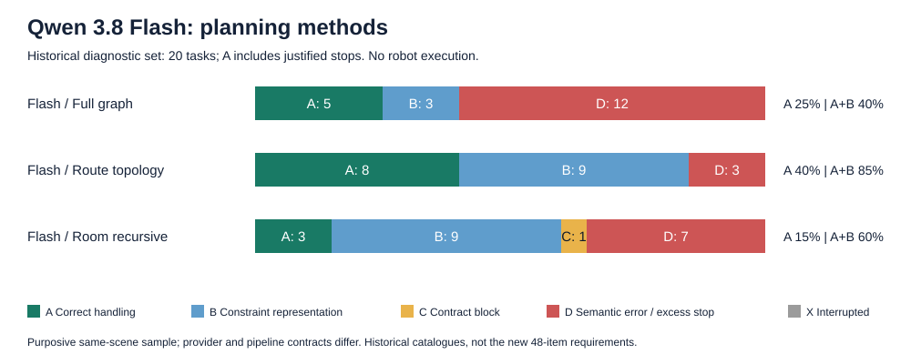
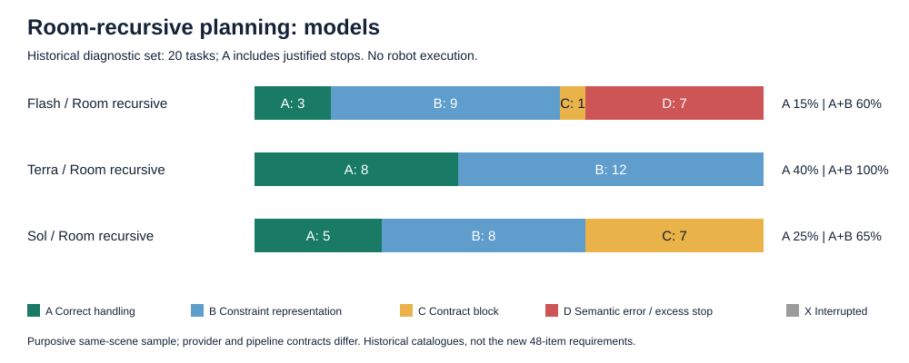
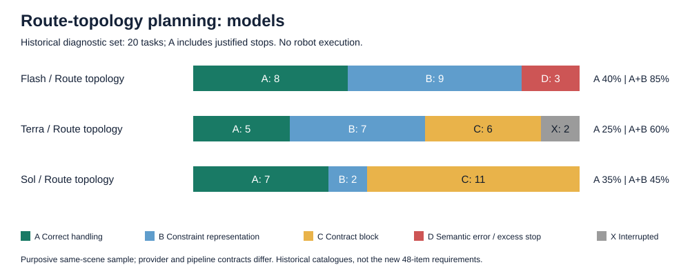

# Historical diagnostic results

These are **saved November 9, 2026 results**, not an evaluation of the current release or the new 48-item skill requirements. No new model requests were made while preparing this repository.

## Study scope

Twenty unique historical Scene200 navigation tasks were deliberately selected: six previously successful cases and fourteen previously problematic cases. Seven configurations produce 140 selected task/configuration records. This is a small, same-scene diagnostic sample, not a random benchmark. Source scene assets and raw private logs are not redistributed. References and ratings were prepared in an AI-assisted offline audit, not independent human ground truth.

The full-graph arm passes the complete scene to the three-stage planner. The route-topology arm prebinds ordered targets, uses BFS over room connections, crops the scene and then invokes the three stages. The room-recursive arm plans visits incrementally with room context and within-run symbolic memory. The latter is a historical comparison unless explicitly listed as executable release scope in README. BFS minimizes room hops, not physical distance.

## Rating definitions

- **A**: Correct complete plan or evidence-supported clarification followed by a stop.
- **B**: Navigation target/order/terminal state are correct, but preservation constraints are not fully represented in the structured output.
- **C**: Intent or binding is broadly consistent, but a schema or engineering contract prevents complete plan delivery.
- **D**: Wrong referent/order/goal or unnecessary clarification.
- **X**: Network or budget interruption; ungraded.

Strict correct handling is A, including justified clarification. Relaxed symbolic-navigation usability is A+B. B is not a claim that an omitted constraint is harmless during physical execution. A plan and A stop are listed separately. A complete artifact is a delivery metric and does not imply semantic correctness. In two original-baseline cases a justified final stop takes precedence in the agreed grade even though earlier decomposition problems were also recorded.

## Selected outcomes

| Model | Method | Complete artifacts | A plan | A justified stop | B | C | D | X | Strict A | Relaxed A+B |
|---|---|---:|---:|---:|---:|---:|---:|---:|---:|---:|
| Qwen 3.8 Flash | Full graph | 16/20 | 3 | 2 | 3 | 0 | 12 | 0 | 5/20 (25%) | 8/20 (40%) |
| Qwen 3.8 Flash | Route topology | 14/20 | 5 | 3 | 9 | 0 | 3 | 0 | 8/20 (40%) | 17/20 (85%) |
| Qwen 3.8 Flash | Room recursive | 15/20 | 2 | 1 | 9 | 1 | 7 | 0 | 3/20 (15%) | 12/20 (60%) |
| GPT 6.1 Terra · medium | Route topology | 10/20 | 3 | 2 | 7 | 6 | 0 | 2 | 5/20 (25%) | 12/20 (60%) |
| GPT 6.1 Terra · medium | Room recursive | 18/20 | 6 | 2 | 12 | 0 | 0 | 0 | 8/20 (40%) | 20/20 (100%) |
| GPT 6.1 Sol · medium | Route topology | 7/20 | 5 | 2 | 2 | 11 | 0 | 0 | 7/20 (35%) | 9/20 (45%) |
| GPT 6.1 Sol · medium | Room recursive | 12/20 | 4 | 1 | 8 | 7 | 0 | 0 | 5/20 (25%) | 13/20 (65%) |

## Three matched comparison views

### Qwen 3.8 Flash: planning methods

### Room-recursive planning: models

### Route-topology planning: models

## Reported token usage

| Model / method | Reported input | Reported output | Reported total | Response records | Unknown usage records |
|---|---:|---:|---:|---:|---:|
| Flash / Full graph | 5,485,577 | 56,053 | 5,541,630 | 54 | 0 |
| Flash / Route topology | 4,698,120 | 48,201 | 4,746,321 | 62 | 0 |
| Flash / Room recursive | 4,069,650 | 24,395 | 4,094,045 | 131 | 0 |
| Terra / Route topology | 3,823,917 | 23,957 | 3,847,874 | 63 | 1 |
| Terra / Room recursive | 3,689,064 | 16,114 | 3,705,178 | 137 | 0 |
| Sol / Route topology | 3,821,913 | 26,214 | 3,848,127 | 63 | 0 |
| Sol / Room recursive | 2,983,787 | 16,953 | 3,000,740 | 108 | 0 |

Counts include early stops and selected continuation results. They exclude discarded superseded attempts and are not total account billing. Unknown usage is not zero; Terra/topology has one unknown record, so its total is incomplete. Cache-hit input remains included in input tokens. Different tokenizers, prompts, output contracts and stopping stages prevent interpreting these aggregates as a controlled cost or efficiency comparison. No monetary cost is inferred.

## Interpretation and limits

- In the relaxed grading, Flash improves from 8/20 full-graph to 17/20 topology, while recursive Flash scores 12/20. This describes this selected set only.
- Terra/recursive reaches 20/20 A+B, consisting of six A plans, two A stops and twelve B plans; this is not 20 strictly correct executable robot plans.
- Sol has many contract-blocked results. Its completed navigation cores matched the review references, but completion-conditioned results have survival bias. They do not establish overall superiority or infer missing plans as successful.
- Terra/topology includes a network failure (H16) and budget interruption (H19). These are X, not model mistakes. The denominator remains 20; neither is silently dropped.
- Models, providers, interface/schema projection and historical prompt/skill versions differ. These are confounders, so outcomes cannot be attributed solely to reasoning ability, topology, sequence length or context compression.
- No controller, robot, collision avoidance or physical task execution was evaluated here.

## Provenance

Machine-readable counts, English instructions and all seven per-task grades are in [historical_results.json](historical_results.json). The source audit-data SHA-256 is `a8f290ba04918f128a64e9251aecf92ccf9d5c353729359f0ab9504a4f25c023`. Raw local paths are deliberately excluded from the public data. See [failure_cases.md](failure_cases.md) for representative errors and [task_ratings.md](task_ratings.md) for the task table.
